<div align="center">

<picture>
  <source media="(prefers-color-scheme: dark)" srcset="./assets/banner-dark.svg">
  
</picture>

<a href="https://ghism137.github.io">
  
</a>

<br>

<a href="https://ghism137.github.io"></a>


</div>

---

### 🦆 `$ cat about_me.py`

```python
class Ghism:
    name     = "Trần Thái Hưng"
    alias    = "ghism"
    major    = "Computer Science — Data Science & AI"
    motto    = "My lives matters."

    interests = ["ML math", "competitive programming", "AI agents",
                 "quant finance", "history", "philosophy"]
    currently = ["RAG agent for Vietnamese labor law",
                 "graph algorithms × stock markets"]

    def fun_fact(self):
        return "I explain my bugs to a rubber duck. The duck is below. It eats commits."
```

---

### 🚀 Featured projects

| | Project | What it does | Stack |
|:-:|---|---|---|
| ⚖️ | [**Vietnamese Labor-Law AI Agent**](https://github.com/ghism137/AI_Agent_Ho_tro_tra_cuu_va_soan_thao_van_ban_phap_ly_luat_lao_dong) | RAG agent that answers labor-law questions **with citations**, computes severance / probation pay / unemployment insurance **deterministically (no LLM math)**, and drafts legal forms. 100+ legal documents → 2,041 article-level chunks, hybrid BM25 + dense search. *Evaluation set in progress.* | BGE-M3 · Qdrant · Pydantic · Jinja2 |
| 💳 | [**IEEE-CIS Fraud Detection**](https://github.com/ghism137/IEEE-Fraud-Detection-with-Machine-Learning) | Leakage-proof pipeline on 590k transactions (3.5% fraud): purged time-split, 337 engineered features, 8-model comparison. **AUC-PR 0.504 (14.3× over random)**, AUC-ROC 0.906, cost-optimal threshold t = 0.365 cuts business cost by ~$8.9k vs. t = 0.5. | LightGBM · XGBoost · CatBoost · SHAP |
| 🌳 | [**Stock Clusters via MST**](https://github.com/ghism137/Stock-Correlation-Detection-via-Minimum-Spanning-Tree-MST-) | Econophysics: turns return correlations into the metric $d_{ij}=\sqrt{2(1-\rho_{ij})}$, builds the MST with **hand-written Prim & Kruskal + Union-Find**, validates sectors with ARI/NMI and a permutation test, tracks crises with rolling MSTs. | NumPy · NetworkX (cross-check) · Markowitz |
| 🛢️ | [**Oil Spill SAR Segmentation**](https://github.com/ghism137/oil-spill-sar-segmentation) | Team deep-learning project: 3 segmentation models on SAR imagery, ensembled (average probability), served in a Streamlit app with upload → mask → overlay. Evaluated by Dice / IoU. | PyTorch · Streamlit |

---

### 🧰 Tech stack

<p align="center">
  
</p>

<p align="center">
  
  
  
  
  
  
  
  
  
</p>

---

### 🏆 Achievements

- 🥉 **Third Prize — ICPC Northern Vietnam**
- 📜 **Coursera certificates**
  - **Cloud:** Architecting Solutions on AWS · AWS Cloud Technical Essentials · Introduction to Cloud Computing (IBM)
  - **Software:** Introduction to Software Engineering (IBM) · Java Programming for Beginners (IBM)
  - **Networking:** The Bits and Bytes of Computer Networking (Google) · TCP/IP and Advanced Topics (CU System)
  - **Web:** Introduction to Front-End Development (Meta) · Responsive Web Pages with HTML5 & CSS3 (NIIT)
  - **Communication:** English Communication for Tech Professionals (ASU)

---

### 🦆 The duck ate my contribution graph

<picture>
  <source media="(prefers-color-scheme: dark)" srcset="https://raw.githubusercontent.com/ghism137/ghism137/output/duck-dark.svg">
  
</picture>

---

### 📈 Streak

<p align="center">
  
</p>


---

### 📬 Reach me

<p align="center">
  <a href="mailto:tranthaihung137@gmail.com"></a>
  <a href="mailto:sktelfins137@gmail.com"></a>
  <a href="https://ghism137.github.io"></a>
</p>

<div align="center">


<sub>© 2026 ghism · all gradients descended responsibly</sub>

</div>
